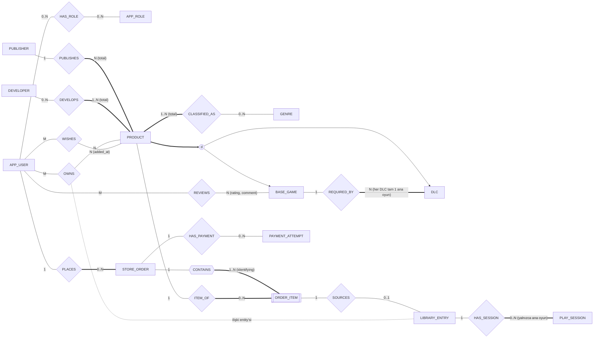
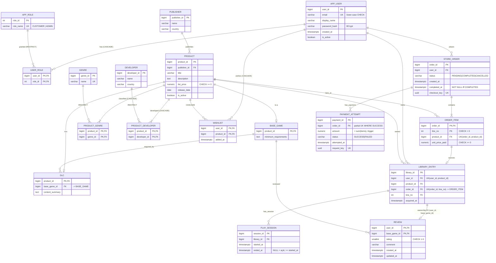

# EER ve ilişkisel şema

Ara rapor Şekil 1 ve Ek A (A.1–A.3) EER çizimlerinin finaldeki tam hâli ve uygulanan ilişkisel şema.
Diyagramlar Mermaid ile yazılmıştır (GitHub / VS Code önizlemesinde çizilir). İlişkisel şema
`backend/src/main/resources/db/migration/V1__core_schema.sql` ile birebir aynıdır.

## 1. EER (Chen gösterimi)

Gösterim: dikdörtgen = entity, çift çerçeve = weak entity, eşkenar dörtgen = ilişki,
`((d))` = disjoint specialization (PRODUCT'tan çıkan **kalın** çizgi = total participation).

Önemli öznitelikler ve anahtarlar: PRODUCT(<u>product_id</u>, title, description, list_price, release_date, is_active);
BASE_GAME(minimum_requirements); DLC(content_summary); ORDER_ITEM(<ins>line_no</ins> partial key, unit_price_paid);
STORE_ORDER(<u>order_id</u>, status, created_at, completed_at, checkout_key); PAYMENT_ATTEMPT(<u>payment_id</u>, amount, status,
attempted_at, request_key); LIBRARY_ENTRY(<u>library_id</u>, acquired_at); PLAY_SESSION(<u>session_id</u>, started_at, ended_at);
REVIEWS ilişki öznitelikleri rating, comment, created_at, updated_at; WISHES ilişki özniteliği added_at.

Participation ve kardinalite matrisi rapor §3 tablosu ile aynıdır.

## 2. İlişkisel şema (uygulanan)

## 3. Tablolar arası kurallar (trigger) — özet

| Nesne | Tür | Kural |
|---|---|---|
| `base_game_disjoint`, `dlc_disjoint` | BEFORE | BR01 disjoint |
| `product_subtype_total`, `base_game_subtype_total`, `dlc_subtype_total` | DEFERRABLE INITIALLY DEFERRED | BR01 total |
| `product_classification`, `product_genre_minimum`, `product_developer_minimum` | DEFERRED | En az bir genre ve developer |
| `store_order_has_items`, `order_item_minimum` | DEFERRED | BR04 sipariş ≥ 1 kalem |
| `store_order_state` | BEFORE | BR08/BR09 durum makinesi |
| `order_item_guard` | BEFORE | BR07/BR08 kalem yalnızca PENDING'e eklenir, değiştirilemez |
| `payment_attempt_guard` | BEFORE | BR09 PENDING şartı, BR04 tutar = Σ kalem, geçmiş değişmez |
| `payment_success_completes_order` | DEFERRED | BR09 SUCCESS ⇒ aynı transaction'da COMPLETED |
| `library_entry_source` | DEFERRED | BR04 kaynak tutarlılığı, BR05 DLC ön koşulu |
| `library_entry_immutable` | BEFORE | BR02 sahiplik kalıcı |
| `play_session_guard` | BEFORE | BR06 yalnızca BASE_GAME, edinimden sonra |
| `review_update` | BEFORE | BR06 anahtar değişmez, updated_at |

İndeksler: 18 PK/UQ indeksi, FK destek indeksleri (V1) ve rapor §8.2'nin beş adayı (V4).
View'lar: `v_order_summary`, `v_game_sales_monthly`, `v_library_playtime`, `v_product_rating`, `v_public_review`,
`rpt_overview`, `rpt_user_activity_monthly`, `rpt_q1`…`rpt_q5` (V3).
